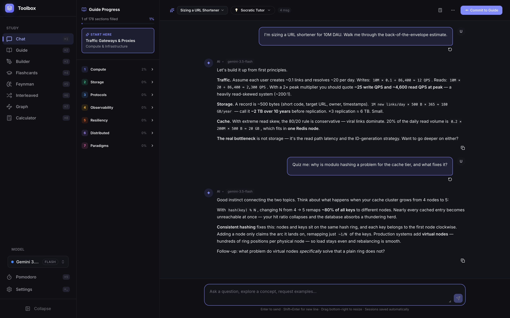
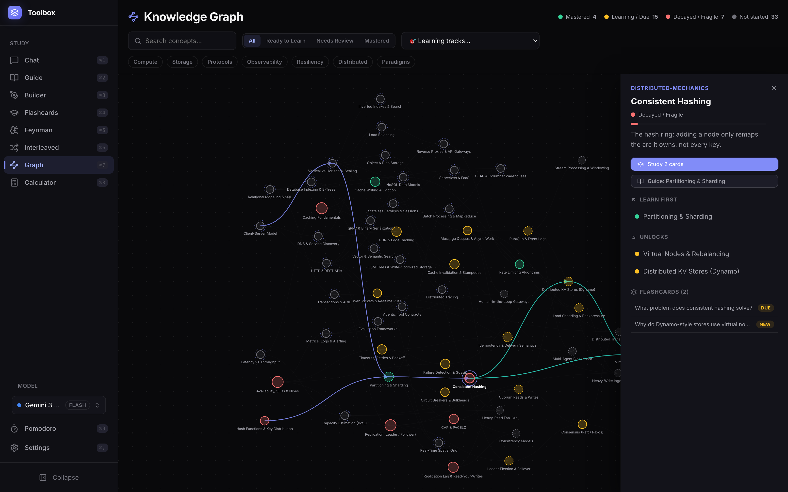
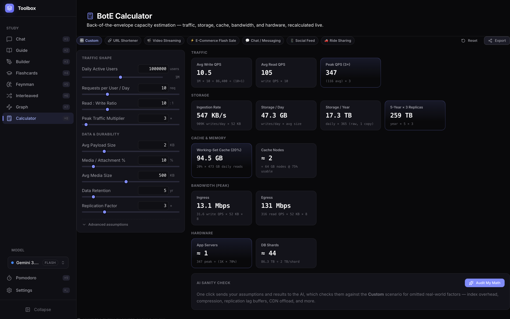
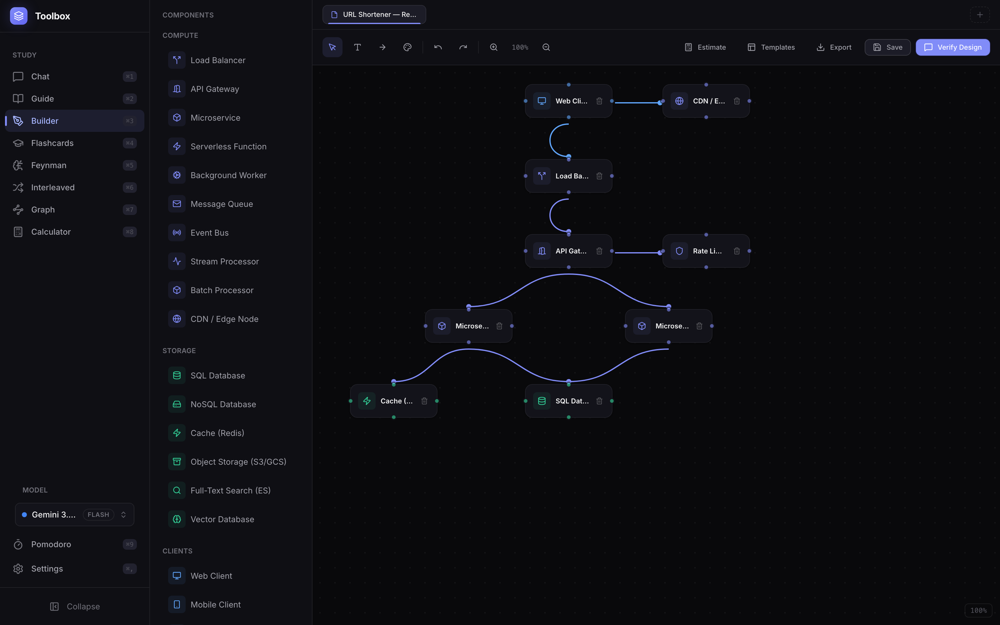
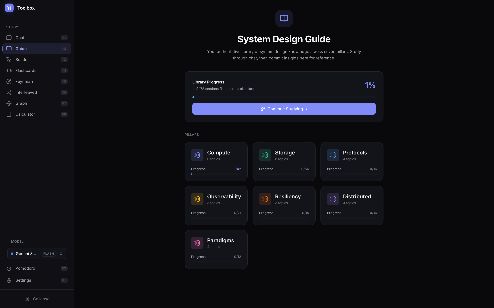
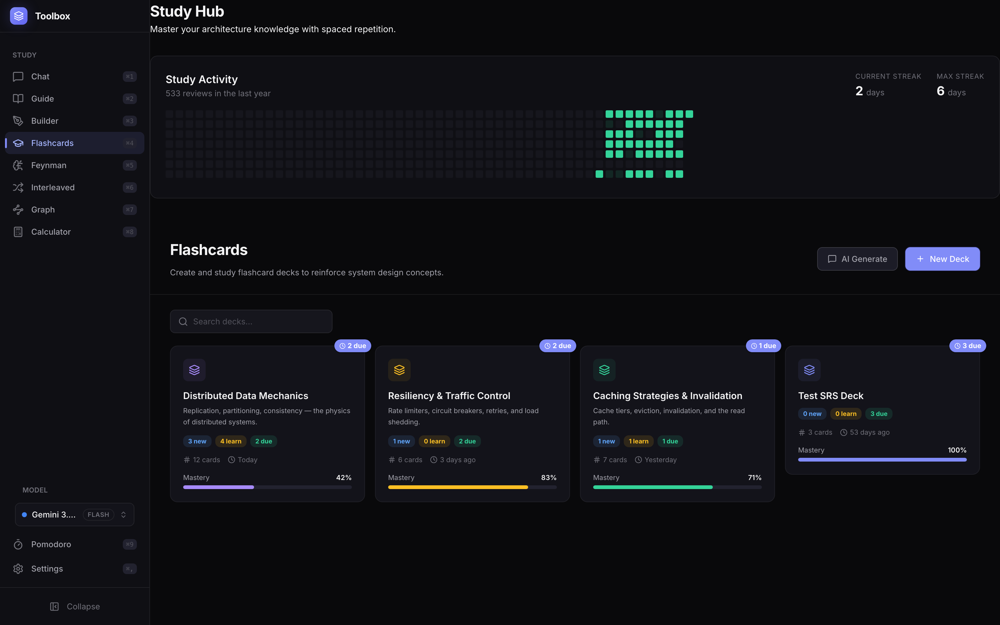
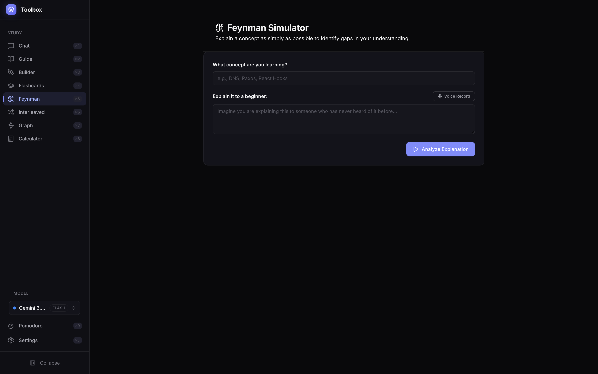

<div align="center">

# 🧰 Toolbox

**A self-hosted, multi-tenant AI study platform built around portable learning Kits**

[](https://hub.docker.com)
[](LICENSE)

</div>



Toolbox v2 is a self-hosted web app for mastering complex domains through AI-synthesized **Kits** (shipping with an official **System Design Starter Kit** out of the box). Compile custom Kits from any topic, PDF, Markdown file, or URL; practice with FSRS-6 spaced repetition, prerequisite-graph credit propagation, anti-sycophancy drills, and dual-mode visual canvases — backed by a single SQLite file.

---

## ✨ Features

| Feature | Description |
|---------|-------------|
| 📦 **Multi-Kit Library & Sharing** | Organize study workspaces into portable Kits (`<slug>.toolbox-kit.json` skeletons and `<slug>.toolbox-backup.zip` full backups with uploaded sources, cards, notes, and boards) plus an instance-wide Shared Library (`/shared`). |
| 🧬 **4-Stage Deep Research Kit Compiler** | Build a Kit on any domain (`/new`) via source ingestion (`unpdf` / Markdown / URLs), diagnostic calibration, SearXNG-grounded curriculum DAG synthesis, interactive refinement, and Living Kit sub-DAG expansion. |
| 📚 **FSRS-6 + FIRe Graph Credit** | Pure-TypeScript 21-weight FSRS-6 scheduler (`desired_retention` targeting, lazy v1 SM-2 migration) paired with **FIRe-Lite** upward fractional credit to prerequisites and downward remediation queues on lapses. |
| 🎯 **Guided Drills & `⚡ Challenge Node`** | Attempt-gated recall, application, synthesis, and critique drills with progressive hints, errors-first anti-sycophancy grading, and a first-principles `⚡ Challenge Node` diagnostic to fast-track mastered topics. |
| 🎨 **Dual-Mode Canvas** | Per-Kit `architecture` whiteboard (25+ system components, templates) or Novakian `concept` map (labeled linking phrases), both with structured AI rubric critique. |
| 🤖 **Capability Router, BYOK & Hybrid RAG** | Route `quick`, `deep`, and `research` tasks across Gemini, OpenAI, Claude, or any OpenAI-compatible endpoint (Ollama, vLLM, LM Studio, OpenRouter), with per-user encrypted BYOK keys and local `sqlite-vec` + `FTS5` Reciprocal Rank Fusion search. |
| 🖼️ **Constructive Diagrams & Math** | Strict-sanitized inline `language-svg` figures, strict-mode Mermaid diagrams, and bundled offline KaTeX math rendering. |
| 🔐 **Zero-Friction Local or Multi-Tenant Auth** | Runs out of the box with an implicit local owner (`AUTH_REQUIRED=false`), or scales to multi-user auth with `scrypt` passwords, Passkeys (WebAuthn), OIDC SSO, audit logs, and online SQLite backups. |
| 🔌 **Built-In MCP Server** | Stateless Streamable HTTP Model Context Protocol endpoint (`POST /api/mcp`) secured by personal `tbk_` bearer tokens (read-write or read-only) for Claude Desktop, Cursor, and CLI agents. |
| 🧮 **BotE Calculator & Focus Tools** | Back-of-the-envelope capacity sandbox with AI math audit (enabled per Kit capability), voice-capable Feynman evaluator, cross-Kit `/review` queue, and Pomodoro focus timer. |

---

## 📸 Screenshots

<table>
  <tr>
    <td align="center"><em>Knowledge Graph — prerequisite DAG with live FSRS-6 retrievability</em></td>
    <td align="center"><em>BotE Calculator — capacity estimation sandbox</em></td>
  </tr>
  <tr>
    <td></td>
    <td></td>
  </tr>
  <tr>
    <td align="center"><em>Architecture & Concept Canvas</em></td>
    <td align="center"><em>Structured Knowledge Guide</em></td>
  </tr>
  <tr>
    <td></td>
    <td></td>
  </tr>
  <tr>
    <td align="center"><em>FSRS-6 Spaced Repetition Flashcards</em></td>
    <td align="center"><em>Feynman First-Principles Evaluator</em></td>
  </tr>
  <tr>
    <td></td>
    <td></td>
  </tr>
</table>

---

## 🚀 Quick Start

### Docker Compose (Recommended)

```bash
git clone https://github.com/arvarik/toolbox.git
cd toolbox
cp .env.example .env
# Optional: set GEMINI_API_KEY / OPENAI_API_KEY / CLAUDE_API_KEY in .env (or configure in Settings UI)
docker compose up -d
```

Open `http://localhost:3100`.

### Local Development (Node.js ≥ 24)

```bash
npm install
npm run dev   # Vite (:5173) + Express (:3100, native TypeScript)
```

---

## 📚 Documentation

| Document | Description |
|----------|-------------|
| [User Guide](docs/user-guide.md) | Library workflows, Kit Compiler, Guided Drills, Canvas modes, MCP setup, shortcuts |
| [API Reference](docs/api.md) | REST endpoints (Auth, Admin, Kits, Compiler, AI Router, Pedagogy) + MCP protocol |
| [SRS & Pedagogy Spec](docs/srs-algorithm.md) | FSRS-6 21-weight DSR math, FIRe-Lite graph credit, remediation, anti-sycophancy |
| [Deployment Guide](docs/deployment.md) | Docker (`node:24-trixie-slim`), reverse proxies, OIDC/Passkeys, SearXNG, airgapped ONNX |
| [Architecture](docs/architecture.md) | TypeScript stack, `platform/` boundary, tenant-scoped SQLite + `sqlite-vec`, worker isolation |
| [Design Reference](docs/design.md) | Tailwind v4 semantic `@theme` tokens (WCAG AA), legacy CSS classes, SVG sanitizer rules |
| [Agent Instructions](docs/AGENTS.md) | Invariants, `Scope` / `tenant-lint` rules, and codebase gotchas for coding agents |
| [Contributing](CONTRIBUTING.md) | Dev setup, `oxlint` / `tsc` / `tenant-lint` gates, Vitest & Playwright suites |

---

## ⚙️ Core Configuration

| Variable | Default | Description |
|----------|---------|-------------|
| `PORT` | `3100` | HTTP server port |
| `DATA_DIR` | `./data` | Directory for SQLite DB, backups, ONNX models, and `secret.key` |
| `DB_PATH` | `./data/toolbox.db` | SQLite database path (auto-migrates v1 databases in place) |
| `AUTH_REQUIRED` | `false` | Set `true` to require login immediately (auto-enables once an account is created) |
| `PUBLIC_URL` | — | Canonical `https://...` origin (required for Passkeys & OIDC behind a reverse proxy) |
| `TRUST_PROXY_HOPS` | `0` | Number of reverse-proxy hops to trust (`0`–`10`) |
| `TOOLBOX_SECRET_KEY` | auto-generated | 32-byte hex/base64 key for `AES-256-GCM` credential encryption at rest |
| `GEMINI_API_KEY` / `OPENAI_API_KEY` / `CLAUDE_API_KEY` | — | Instance AI keys (also configurable in Admin Settings or per-user BYOK) |
| `SEARXNG_URL` | — | Self-hosted SearXNG URL for grounded web research |

See [`.env.example`](.env.example) and [`docs/deployment.md`](docs/deployment.md) for OIDC, SMTP, airgapped model pre-fetching, and backup settings.

---

## 🛠️ Tech Stack

Node.js 24 (native TypeScript) · Express 5 · SQLite (`better-sqlite3` + `sqlite-vec` + `FTS5`) · `@huggingface/transformers` (`all-MiniLM-L6-v2` ONNX worker) · Zod v4 · Model Context Protocol SDK · React 19 · Vite 8 · Tailwind CSS v4 · Zustand · React Flow (`@xyflow/react`) + `dagre` · Vercel AI SDK

---

## 📄 License

MIT
