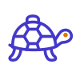
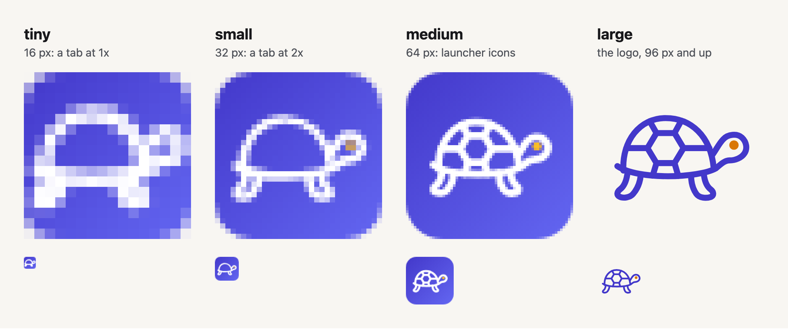
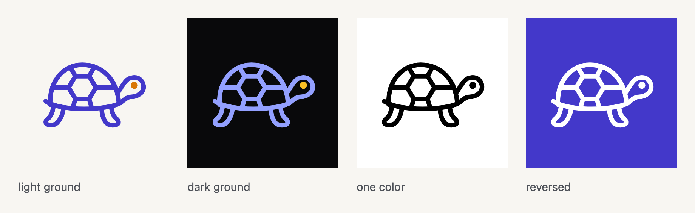
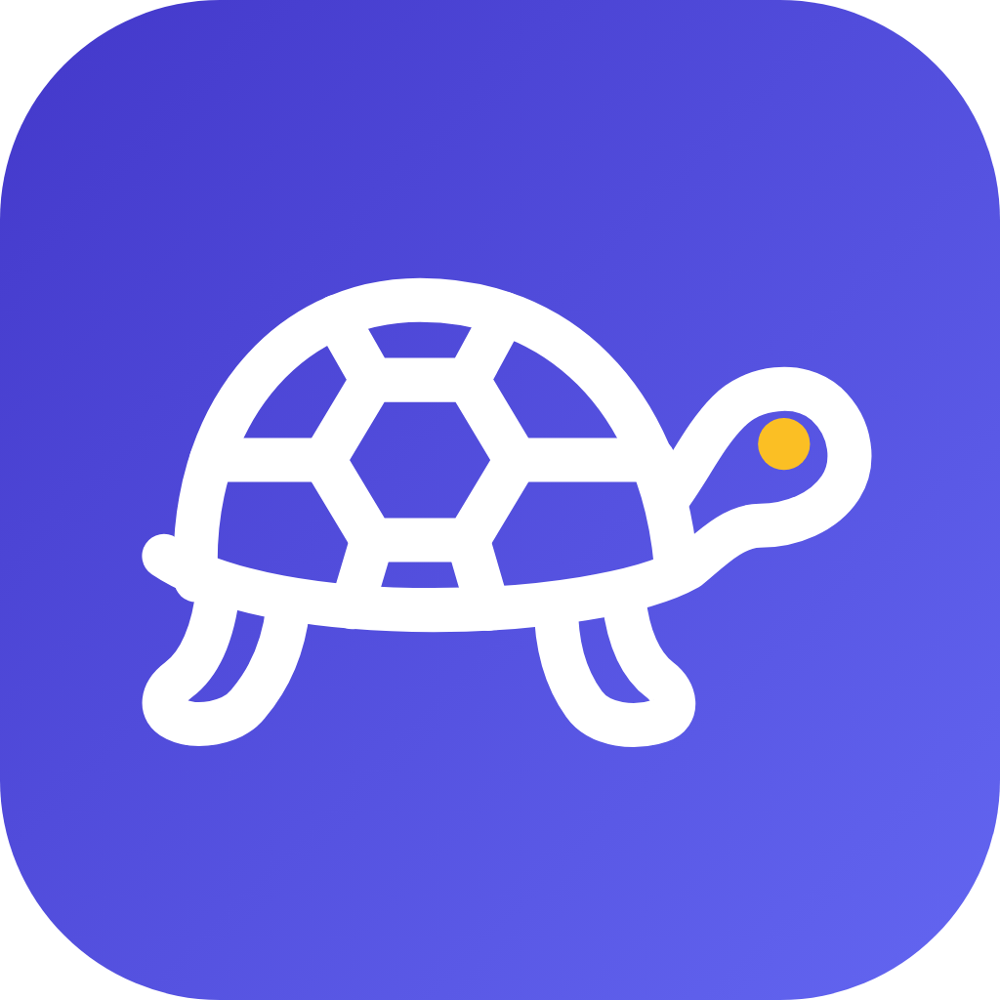

# The Toolbox brand

This folder is the brand kit: Kit the box turtle, the tagline, the versions
of the logo, and the app icon. One script draws every file here from one
drawing.

```bash
npm run brand   # writes docs/brand/, then commit what it writes
```

Never edit a generated file by hand. Change the drawing, the masters, or the
colors in `scripts/brand/kit.ts`, run the script, and commit the result. The
script renders the PNGs with the Chromium that Playwright installs for the
end-to-end tests.

## Meet Kit



Kit is a box turtle whose shell is a toolbox. Kit learns slowly and keeps
what it learns, which is how Toolbox teaches.

- **Slow and steady wins.** Spaced practice beats cramming over weeks and
  months. Robert Bjork calls this a "desirable difficulty": study that feels
  slower now makes memory last longer. Toolbox schedules reviews, interleaves
  topics, and asks you to recall before it shows answers for this reason.
- **Foundations first.** A turtle's shell grows one layer at a time, and every
  topic in a Kit rests on its prerequisites.
- **The name holds the product.** A box turtle named Kit carries both words
  for a tool container. Kit also carries its home on its back, like a portable
  Kit or a self-hosted server.
- **The turtle is an old tool for thought.** Seymour Papert's Logo language
  used a turtle to teach children math and programming. In _Mindstorms_ (1980)
  he called it an "object-to-think-with."

The drawing has six parts, each one round-capped stroke, and an eye:

- **The dome** and **the body.** The body is one line from the neck, around
  the head, under the shell, and out to the tail.
- **The plates.** The center plate is a hexagon, the shape of a hex nut.
- **The seams** from the plates to the rim, and **the two legs**, mid-stride.
- **The eye** is amber, close to the orange eye of a male eastern box turtle.

## The tagline

**Tools for Thought.** Write it in title case, under or after the name:
"Toolbox: Tools for Thought." Do not shorten it or add words to it.

The phrase names software that helps people think and remember. Howard
Rheingold used it for his 1985 book _Tools for Thought_. Andy Matuschak and
Michael Nielsen used it in their 2019 essay "How can we develop transformative
tools for thought?", whose main example is spaced repetition. It also
alliterates with the name.

## Optical sizes

One stroke cannot serve every size. A stroke that reads in a 16 px tab looks
like a slab on a home screen. So the mark has four masters. Each draws the
same paths with the stroke, the eye, and the parts that suit the size a
person sees.



| Master   | Seen at              | Parts                       | Stroke | Eye  |
| -------- | -------------------- | --------------------------- | ------ | ---- |
| `tiny`   | 16 px on a 1x screen | dome, body, legs            | 8.5    | none |
| `small`  | 17 to 47 px          | adds the eye                | 5.2    | 2.8  |
| `medium` | 48 to 95 px          | all six                     | 4.4    | 2.6  |
| `large`  | 96 px and up         | all six                     | 3.6    | 2.8  |

Strokes and eyes are in the mark's 100-unit box. The size a person sees picks
the master, not the file's pixels: a 512 px launcher icon shows at about
48 dp, so it takes `medium`.

## Color

| Color         | Hex       | Token                                  | Use                                       |
| ------------- | --------- | -------------------------------------- | ----------------------------------------- |
| Primary       | `#4338ca` | `--color-primary`, light               | Kit on a light ground, the tile's start   |
| Primary, dark | `#93a0ff` | `--color-primary`, dark                | Kit on a dark ground                      |
| Tile end      | `#6366f1` | `--color-accent`, light, in `index.css`| The tile's end                            |
| Eye           | `#d97706` | none                                   | The eye on a light ground                 |
| Eye, dark     | `#fbbf24` | `--color-warning`, dark                | The eye on a dark ground and on the tile  |
| Surface       | `#f8f6f2` | `--color-surface`, light               | A light ground                            |
| Surface, dark | `#09090b` | `--color-surface`, dark                | A dark ground                             |

`COLORS`, `GROUND`, and `TILE` in `scripts/brand/kit.ts` hold these as
literals, because a favicon cannot read a CSS token.

| Pair                                | Contrast |
| ----------------------------------- | -------- |
| White Kit on the tile's dark corner | 7.90:1   |
| White Kit on the tile's light corner| 4.47:1   |
| Kit on the light surface            | 7.32:1   |
| Kit on GitHub's light page          | 7.90:1   |
| Dark Kit on the dark surface        | 8.25:1   |
| Dark Kit on GitHub's dark page      | 7.85:1   |

WCAG 1.4.11 asks 3:1 for a graphic that a person must make out. The eye is
decoration, so it can go lower: amber on the light surface is 2.95:1.

## Versions of the mark



| File                 | Use                                                    |
| -------------------- | ------------------------------------------------------ |
| `kit-mark.svg`       | A light ground: the primary with the amber eye         |
| `kit-mark-dark.svg`  | A dark ground: the dark primary with the dark eye      |
| `kit-mark-black.svg` | One color: print, embossing, a surface with one ink    |
| `kit-mark-white.svg` | One color, reversed out of a color or a photograph     |

`kit-mark.png` and `kit-mark-dark.png` are the first two at 512 px, for places
that cannot show an SVG.

## The app icon



`kit-app-icon.svg` is the master for every launcher, home screen, and store
icon: the `medium` master in white on the indigo tile. The tile has corners of
22 percent of its side, the corner of an iOS icon. Kit is drawn at 80 percent
scale about the tile's middle. `kit-app-icon-1024.png` is the same icon for stores
and press kits.

## Clear space and minimum size

- **Clear space.** Keep other elements at least a quarter of the mark's height
  away from Kit, on every side.
- **Minimum size.** The logo files use the `large` master and read down to
  48 px. Below that, use the `small` or `tiny` master on the tile.

## Do and do not

Do:

- Use the generated files, at the size their master is for.
- Use the dark version on a dark ground and the white one on a photograph.
- Keep Kit calm and steady in words and pictures. Say "steady" more than
  "slow."

Do not:

- Redraw, stretch, rotate, or slant the mark, or add a shadow or an outline.
- Recolor the eye in the color versions.
- Use Kit as a loading spinner or on a timeout screen. A slow turtle there
  says the app is slow.
- Draw Kit to look like a famous cartoon turtle, or give Kit a mask or a
  weapon.
